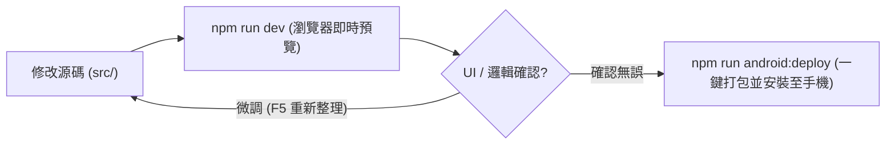

# DEVELOPMENT.md — 開發流程與操作手冊 (Engineering Workflows & Runbook)

本專案為獨立之 **DualRing Clock Android App**（基於 Capacitor + 原生 ES Module SPA 架構）。

---

## 1. 核心開發流程：瀏覽器優先 (Browser First, Device Second)

為求最高開發效率，開發流程分為 **「瀏覽器即時調校」** 與 **「實機一鍵輸出部署」** 兩階段：



---

### 階段一：在瀏覽器上看結果（免編譯，秒速反饋）

開發時直接啟動本地開發伺服器，直接讀取 `src/` 與 `assets/` 原始碼：

```bash
npm run dev
# 或
npm run preview
```

瀏覽器訪問：
- **即時全螢幕預覽**：`http://127.0.0.1:4173/`
  > 建議在 Chrome / Edge 中按 `F12` 開啟 DevTools，切換為「行動裝置模擬」（如 iPhone 14 或 Pixel 7），即可測試觸控拖曳手感、地圖拖拉與響應式排版。
- **手機外框模擬器**：`http://127.0.0.1:4173/_dev`
  > 提供裝置下拉選單（Pixel 7、Pixel 5、Galaxy S21、Galaxy Tab S8、Desktop 1280），可切換長寬與密度，方便確認平板與手機雙向適配。

> [!TIP]
> 伺服器直接服務專案根目錄的原始檔案，修改 `src/app/` 或 `src/shared/` 的 HTML/CSS/JS 後，**在瀏覽器按 `F5` 重新整理立即生效**，不需等待 APK 編譯。

---

### 階段二：確認後執行輸出腳本（一鍵打包與實機安裝）

在瀏覽器確認功能與畫面無誤後，將 Android 手機以 USB 線連接電腦（需啟用「USB 偵錯」），執行部署腳本：

#### 完整編譯並部署（推薦）：
```bash
npm run android:deploy
```
或在 PowerShell 直接執行：
```powershell
.\tools\deploy-apk.ps1
```

腳本會自動依序完成：
1. **打包 Web 資產**：執行 `tools/build-android-web.mjs`，將 `src/` 與 `assets/` 同步至 `android-web/`。
2. **同步 Capacitor**：執行 `npx cap sync android`，將 Web 資產寫入原生 Android 資產目錄。
3. **編譯 Debug APK**：自動偵測 Android Studio JBR，透過 Gradle 編譯出 `app-debug.apk`。
4. **ADB 安裝與啟動**：透過 ADB 覆蓋安裝至已連接的手機並自動開啟 DualRing Clock。

#### 其他實用指令：
```bash
# 僅編譯 APK，不連線手機安裝（產物：android/app/build/outputs/apk/debug/app-debug.apk）
npm run android:build
# 或 .\tools\deploy-apk.ps1 -BuildOnly

# 僅安裝既有 APK 到手機（免重新編譯）
npm run android:install
# 或 .\tools\deploy-apk.ps1 -InstallOnly
```

---

## 2. 核心架構規範 (Architecture & Standards)

1. **零建構 (Zero-Build) 原生 ES 模組**：
   - 不使用 Webpack/Vite 等複雜打包工具，直接採用原生 `<script type="module">`。
   - 頁面入口為 `src/app/index.html`，共享工具與元件位於 `src/shared/`。
2. **純同步 `localStorage` 資料儲存**：
   - 不依賴 Chrome Storage API 或非同步存儲，所有城市設定、偏好設定皆即時同步讀寫於原生 `localStorage`。
3. **手機專用 UI 與互動**：
   - **單頁 SPA**：取消 `<iframe>`，透過底欄在「時鐘」「時間軸」「設定」三個頁面之間切換（時鐘目前為空白預留頁）。
   - **城市列表佈局**：4 欄固定網格（`24px 60px minmax(0, 1fr) 28px`），依序為：拖曳手柄（`⋮⋮`）、城市簡稱（60px）、時區下拉選單、刪除按鈕（`×`）。
   - **即時擠開位移動畫**：拖曳城市卡片時不透明（`opacity: 1`），無水平參考線；相鄰卡片在拖曳超過中線時透過 CSS `transform` 即時讓出空位，放手時自動平滑吸入。
4. **多語系 (i18n)**：
   - 支援語系：繁體中文 (`zh`)、英文 (`en`)、西班牙文 (`es`)。
   - 字典定義於 `src/shared/i18n.js`，HTML 元件採用 `data-i18n="key"` 宣告。

---

## 3. 環境必備 (Prerequisites)

- **Node.js**：v18 以上。
- **Android Studio**：
  - 內含 JBR (Java SDK 17/21/25)，腳本會自動尋找預設路徑：
    `C:\Program Files\Android\Android Studio\jbr`
  - Android SDK Platform-Tools（包含 `adb.exe`）。
- **手機端設定**：
  - 「設定」→「開發人員選項」→ 開啟「USB 偵錯」。
  - 首次連接時，手機螢幕若跳出「允許 USB 偵錯嗎？」，請勾選「一律允許」並點擊確定。

---

## 4. 常見問題排除 (Troubleshooting)

- **Q1: 執行 deploy 時提示 `No connected Android devices found`**
  - 請檢查手機是否已插上 USB，並確認 USB 連接模式為「檔案傳輸（MTP）」。
  - 在終端機執行 `adb devices`，若顯示 `unauthorized`，請解鎖手機螢幕並授權偵錯；若顯示空白，請確認傳輸線是否支援資料傳輸。
- **Q2: 瀏覽器預覽時埠號 `4173` 被佔用**
  - 可指定其他埠號啟動：
    ```powershell
    $env:PORT = 5000; npm run dev
    ```
- **Q3: Java / Gradle 報錯**
  - 若未安裝於預設位置，可手動設定環境變數：
    ```powershell
    $env:JAVA_HOME = "你的_JDK_或_JBR_路徑"
    ```
